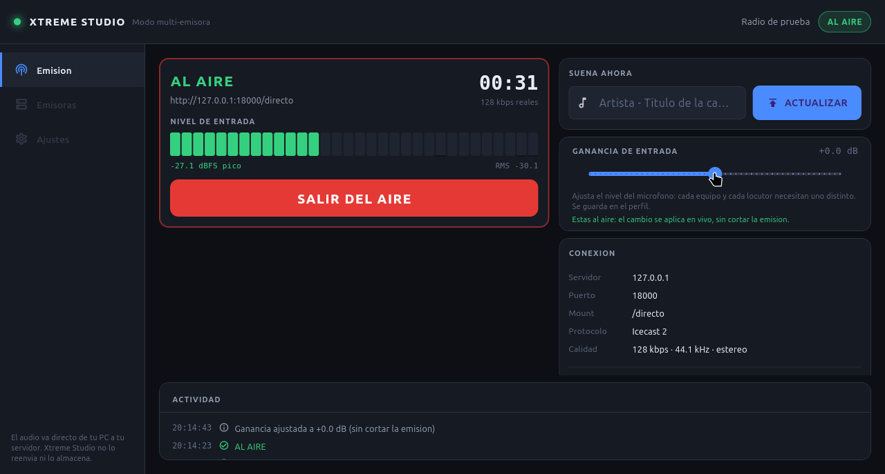

# Xtreme Studio

### Direct radio, no middlemen.

[Español](README.md) · [Web](https://envidia1972-create.github.io/xtreme_studio/) · [Download](https://github.com/envidia1972-create/xtreme_studio/releases/latest) · [Manual](https://envidia1972-create.github.io/xtreme_studio/manual.html)

**Multi-station radio broadcasting console.** Load your server credentials,
pick your microphone and go live. Audio goes straight from your computer to
your Icecast2 or Shoutcast server — no cloud, no account, no middleman.

## Download

| Platform | Package | Updates |
|---|---|---|
| **Windows 10/11 x64** | [Portable ZIP](https://github.com/envidia1972-create/xtreme_studio/releases/latest) | Automatic in-app |
| **Linux x64** | [Portable `.tar.gz`](https://github.com/envidia1972-create/xtreme_studio/releases/latest) | Automatic in-app |

The website always shows the latest version, checksum and release notes:

**<https://envidia1972-create.github.io/xtreme_studio/#descargar>**

## Why Xtreme Studio

- **Multi-station:** one app for all your radio stations.
- **Icecast2 and Shoutcast v1/v2**, including AzuraCast and Zeno.fm.
- **8-pad soundboard**, peak/RMS meter, live gain, recording and metadata.
- **Windows and Linux** with the same engine.
- **Automatic updates** on both platforms.
- **Credentials stay on your machine** (DPAPI on Windows, `0600` on Linux).
- **No sign-up, no ads, no cloud dashboard.**

Built for community radio, independent presenters, live podcasts and stations
that already run Icecast or Shoutcast.

## If it helps, leave a star

Stars help other radio people find the project on GitHub. If Xtreme Studio
saves you time, a star or a share helps a lot.

[⭐ **Star on GitHub**](https://github.com/envidia1972-create/xtreme_studio/stargazers) ·
[Share on X](https://twitter.com/intent/tweet?text=Xtreme%20Studio%2C%20a%20radio%20broadcasting%20console%20for%20Windows%20and%20Linux&url=https%3A%2F%2Fgithub.com%2Fenvidia1972-create%2Fxtreme_studio)

## Documentation

The full documentation is currently in Spanish:

- [Manual (web)](https://envidia1972-create.github.io/xtreme_studio/manual.html)
- [Manual (PDF)](https://envidia1972-create.github.io/xtreme_studio/assets/xtreme-studio-manual.pdf)
- [Issues and suggestions](https://github.com/envidia1972-create/xtreme_studio/issues)
- [Discussions](https://github.com/envidia1972-create/xtreme_studio/discussions)
- [Support the project](https://www.paypal.com/donate/?hosted_button_id=URNUVG7CSFFFQ)
