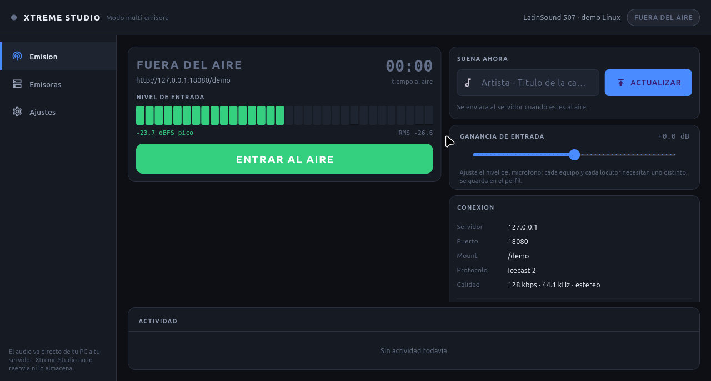
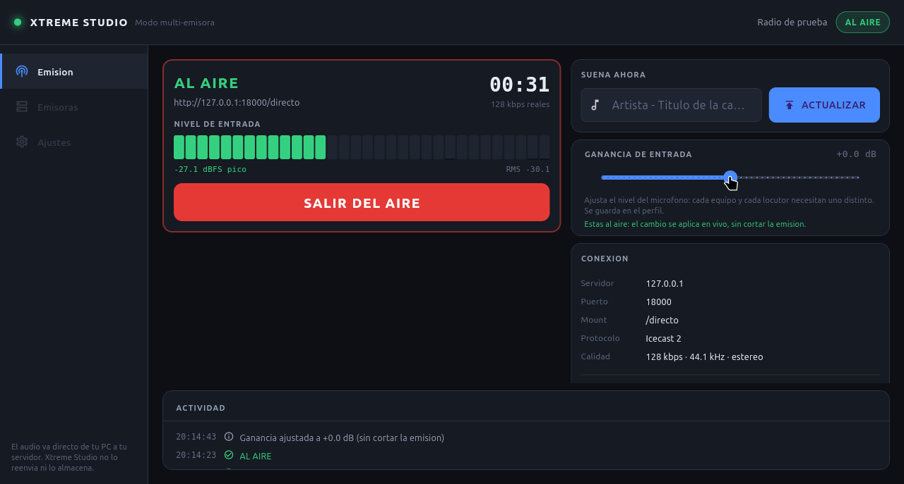
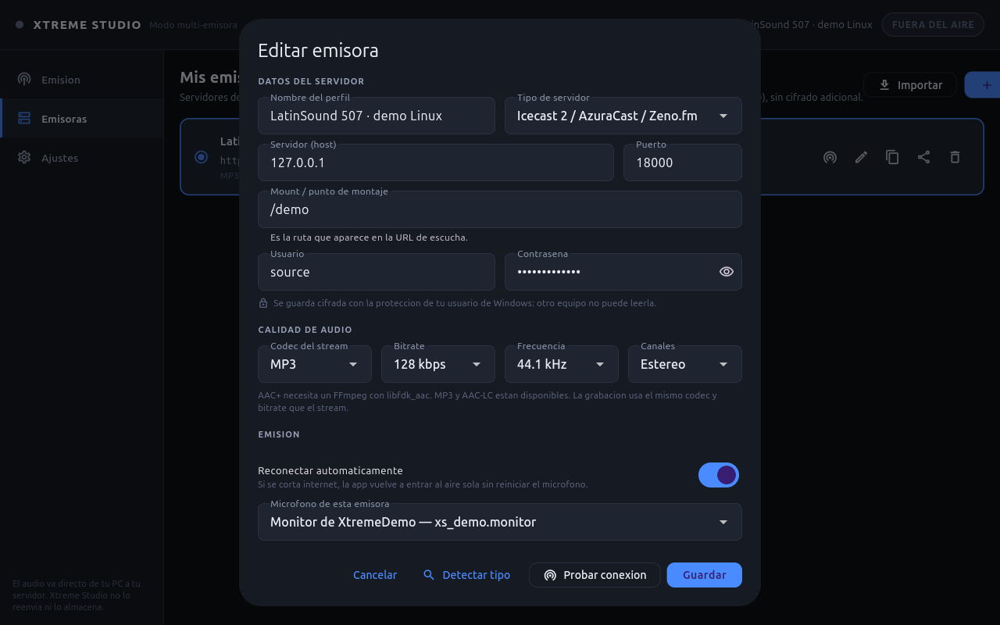
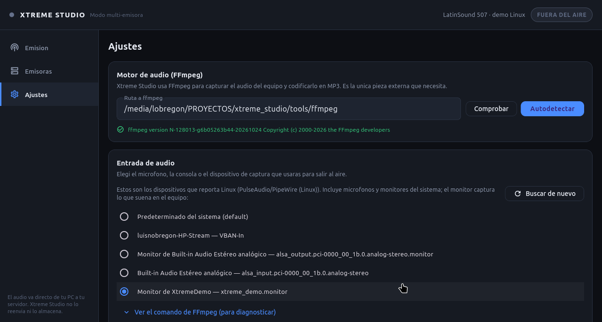

# Xtreme Studio

Consola de emision **multi-emisora** para radio, estilo BUTT pero con marca
propia: cada DJ carga las credenciales de **su** servidor (el tuyo o el de
cualquier otra emisora, en cualquier hosting). El audio sale directo de la PC del
locutor al servidor de streaming: no pasa por ningun servidor intermedio nuestro.

> **Estado:** nucleo completo y **ejecutado y probado en Linux** (**335
> comprobaciones automaticas en este equipo** en nueve suites, incluida una
> emision real con FFmpeg + PulseAudio, otra en AAC-LC y el vumetro de entrada
> siempre activo. La interfaz Flutter corre con runner Linux y verifica
> vumetros, metadatos por la API de Icecast, grabacion, reconexion y apagado.
> Los caminos de Windows (dshow) estan cubiertos por las pruebas de argumentos
> y deteccion; el `.exe` ya se **compilo y arranco** en GitHub Actions
> (`windows-latest`, Flutter 3.47.8 + MSVC). Falta probar el audio real con un
> microfono Windows. ALSA se probo con captura real sobre el PCM `null`.
>
> **Si retomas este proyecto, lee `ESTADO.md`**: ahi esta el punto exacto donde
> se detuvo el trabajo y que queda pendiente.

---

## Que hace hoy

| Funcion | Estado |
|---|---|
| Gestor de emisoras: crear, editar, duplicar, borrar | Listo |
| Protocolos **Icecast 2**, **Shoutcast v1** y **v2** | Listo |
| Credenciales con **DPAPI** en Windows y archivo privado `0600` en Linux/macOS | Listo |
| Boton **PROBAR CONEXION** con diagnostico legible (401, 403, 404...) | Listo |
| **SALIR AL AIRE / SALIR** en un clic | Listo |
| Vumetros de pico y RMS con escala en dBFS | Listo |
| Campo **"suena ahora"** con metadatos en vivo | Listo |
| **Ganancia de entrada** ajustable y guardada por emisora | Listo |
| **Reconexion automatica** con espera creciente, desactivable por emisora | Listo |
| **Deteccion de caida del servidor** y de red estancada (backpressure) | Listo |
| **HTTPS con certificado autofirmado**, aceptable por emisora | Listo |
| **Microfono por emisora** (si no, el de Ajustes) | Listo |
| **Exportacion de perfiles sin contrasena en claro** | Listo |
| **Proteccion contra desplazar a otro DJ** (avisa antes de forzar) | Listo |
| **Comprobacion de la senal publicada** (vista del oyente) | Listo |
| Vumetro de entrada **siempre activo**, tambien fuera del aire | Listo |
| Pico retenido y RMS estables (sin parpadeo) | Listo |
| **Ganancia** audible en el vumetro y en el stream | Listo |
| **"Suena ahora"** por `/admin/metadata` (Icecast/Zeno.fm) | Listo |
| Codec **MP3**, **AAC-LC** y **AAC+** (si el FFmpeg lo soporta) | Listo |
| Bitrate ajustable por emisora (24 a 320 kbps segun codec) | Listo |
| Grabacion local de la emision | Listo |
| Registro de actividad en pantalla | Listo |
| Importar / exportar perfil **sin** contrasena | Listo |
| Interfaz Flutter con runner **Linux** | Verificada en este equipo |
| Captura real por **PulseAudio/PipeWire** | Verificada de punta a punta |
| Captura por **ALSA** | Captura real verificada con el PCM `null`; falta hardware/microfono ALSA |
| Interfaz Flutter en Windows | Compilada y arrancada en GitHub Actions; audio real pendiente |
| Soundboard, notificaciones push, panel web | Pendiente (fases siguientes) |

## Asi se ve en Linux

El vumetro funciona **antes de salir al aire**. Abajo, un tono de 1 kHz capturado
del monitor de un sink virtual de PulseAudio:



Emision real con metadatos actualizados y el titulo que ven los oyentes:



Codigo, bitrate y frecuencia por emisora:



Ajustes con los dispositivos que reporta PulseAudio/PipeWire (incluye
monitores) y el comando exacto que se le pasa a FFmpeg:



---

## Como funciona (y por que asi)

```
  microfono / linea
         |
    [ FFmpeg ]  captura (dshow en Windows; pulse o alsa en Linux)
                y codifica al codec elegido (MP3/AAC)
         |  stdout
    [ motor en Dart ]  -- socket -->  Icecast / Shoutcast
         |  stderr (PCM)
    [ vumetros en pantalla ]
```

Cuatro decisiones que marcan la diferencia frente a "dejar que FFmpeg haga todo":

1. **El socket lo maneja la app, no FFmpeg.** Por eso funciona con Shoutcast
   v1/v2 (que necesitan un *handshake* que `-f mp3` no negocia) y por eso
   podemos leer el codigo HTTP real y decir *"la contrasena fue rechazada"* en
   lugar de un error generico.
2. **La captura nunca se reinicia.** Si se cae la red, solo se rehace el socket.
   El DJ no tiene que volver a elegir el microfono y la grabacion no se corta.
3. **Los metadatos van por una peticion HTTP aparte.** Icecast y Zeno.fm
   actualizan el "suena ahora" con `/admin/metadata?mode=updinfo`; NO se
   insertan bytes de texto dentro del audio. Insertarlos hacia que el servidor
   los interpretara como MP3/AAC y produjera ruido de fondo.
4. **La app pregunta lo mismo que un oyente.** Cada 30 segundos, mientras esta
   al aire, pide la URL de escucha y verifica que el servidor responda con
   audio. Que nuestro socket siga abierto no garantiza que el mount se este
   sirviendo: el servidor puede aceptar la conexion y no publicar la fuente.
   En ese caso el DJ veria "AL AIRE" sin que nadie lo escuche.

   Detalle importante: esa comprobacion usa `GET`, no `HEAD`. Hostings como
   Zeno.fm **rechazan `HEAD` con 405** aunque sirvan el audio perfectamente, asi
   que con `HEAD` el monitor daria falsos avisos justo en los servidores mas
   usados. Se lee solo la cabecera de respuesta y se cierra la conexion.

---

## Nivel de entrada permanente y ganancia

El motor solo captura cuando se sale al aire, pero el DJ necesita ver el nivel
del microfono en todo momento. Por eso la app mantiene un **monitor de entrada**
liviano: un FFmpeg que captura el dispositivo y entrega solo PCM de niveles, sin
codificar MP3/AAC. Cuando se pulsa *SALIR AL AIRE* se detiene ese monitor (en
ALSA el dispositivo es exclusivo) y arranca la captura de emision.

Detalles:

- El vumetro y los numeros funcionan **fuera del aire**, con el dispositivo
  elegido en Ajustes o el asignado a la emisora.
- La ganancia se aplica a la lectura del monitor y al filtro de FFmpeg cuando
  se esta al aire. Mover el control no reinicia el dispositivo.
- El numero de pico usa un **pico retenido durante 2 s**: la lectura queda
  estable en lugar de saltar con cada bloque de PCM.
- Si el dispositivo esta ocupado o desaparece, el monitor se detiene y el
  motivo queda en el registro de actividad.

## Calidad, codec y bitrate

La calidad se elige **por emisora** en *Emisoras > Editar > Calidad de audio*:

| Codec | Encoder de FFmpeg | Bitrates |
|---|---|---|
| MP3 | `libmp3lame` | 64-320 kbps |
| AAC-LC | `aac` nativo | 48-256 kbps |
| AAC+ (HE-AAC) | `libfdk_aac` | 24-128 kbps |

La app consulta los encoders reales con `ffmpeg -encoders`. Si el FFmpeg
instalado no trae `libfdk_aac`, AAC+ aparece como **no disponible** y no se
puede emitir con el; MP3 y AAC-LC si funcionan. Para AAC+ hace falta una build
con `--enable-libfdk-aac --enable-nonfree` (o el paquete de tu distribucion que
la incluya).

**La grabacion usa el mismo codec y bitrate que el stream**, y cambia la
extension del archivo (`.mp3` o `.aac`). Asi lo grabado coincide con lo que
oyen los oyentes. Si necesitas una calidad distinta para la grabacion, se puede
separar en una fase siguiente.

La app anuncia el `Content-Type` correcto (`audio/mpeg`, `audio/aac` o
`audio/aacp`) y mantiene el flujo limpio: sin etiquetas ID3 ni cabeceras Xing al
inicio del MP3, y sin bloques de metadatos dentro del audio.

---

## Compilar

### Linux (verificado en este repositorio)

Requisitos:

- Flutter 3.47.x stable (probado con 3.47.8 / Dart 3.13.7)
- `clang`, `cmake`, `ninja`, `pkg-config` y las cabeceras de GTK 3
- FFmpeg con `libmp3lame` y soporte PulseAudio o ALSA
- PulseAudio o PipeWire en ejecucion (o ALSA directo)

En Ubuntu/Debian:

```bash
sudo apt install clang cmake ninja-build pkg-config libgtk-3-dev ffmpeg
```

Compilar:

```bash
tool/build_linux.sh
```

El script comprueba las dependencias **antes** de empezar, resuelve paquetes,
compila en release y prepara la carpeta distribuible. Resultado:

```
build/linux/x64/release/bundle/xtreme_studio
```

Junto al ejecutable copia `ffmpeg` (si esta en `tools/`), su licencia,
`README.md` y `THIRD_PARTY.md`. La carpeta `bundle/` se puede copiar tal cual a
otra PC Linux de la misma arquitectura.

Si el SDK de Flutter esta en un disco de solo lectura (el caso de este equipo),
`flutter` falla al escribir en `bin/cache`. La solucion incluida es:

```bash
tool/setup_local_sdk.sh /ruta/al/sdk/flutter
source .tooling/env.sh
tool/build_linux.sh
```

Eso copia el SDK y el cache de paquetes a `.tooling/` (ignorado por git) y deja
el HOME del usuario intacto. No hace falta en una instalacion normal.

### Windows

Requisitos:

- Flutter 3.47.x stable, con `flutter` en el `PATH` (o `FLUTTER_BIN` apuntando
  a `flutter.bat`)
- Visual Studio 2022/2026 Build Tools con la carga de trabajo **Desarrollo para
  escritorio con C++**, MSVC, CMake y Windows 10/11 SDK
- Git (Flutter lo usa)
- FFmpeg para Windows (build full/gpl) en `tools\ffmpeg.exe`

Los scripts **ya no tienen rutas fijas**: toman la raiz desde su propia
ubicacion y buscan Flutter en el `PATH`, en `FLUTTER_BIN` o en las rutas
tipicas. No hace falta editar nada.

Primero, comprobar que no falta nada (tarda unos segundos y no compila):

```powershell
cd <ruta-del-proyecto>
powershell -ExecutionPolicy Bypass -File tool\check_toolchain.ps1
```

Luego compilar:

```powershell
powershell -ExecutionPolicy Bypass -File tool\build_windows.ps1
```

Si `flutter` no esta en el `PATH`:

```powershell
$env:FLUTTER_BIN = 'C:\ruta\a\flutter\bin\flutter.bat'
powershell -ExecutionPolicy Bypass -File tool\build_windows.ps1
```

El script comprueba Flutter, MSVC, CMake y el Windows SDK **antes** de empezar
(para no fallar tras varios minutos), resuelve dependencias y deja el ejecutable
en:

```
build\windows\x64\runner\Release\xtreme_studio.exe
```

Tambien copia `ffmpeg.exe`, su licencia, el `README.md` y `THIRD_PARTY.md`
dentro de esa carpeta, que es la que se entrega a otra emisora.

### Windows sin una PC Windows (GitHub Actions)

El repositorio incluye `.github/workflows/windows.yml`. En **Actions → Windows
build → Run workflow** GitHub compila en `windows-latest` y deja la carpeta
`Release` como artifact descargable. El workflow descarga FFmpeg, ejecuta
`check_toolchain.ps1`, corre `verify_core` en Windows y compila con
`build_windows.ps1`.

**Ya verificado:** run `40232577146` termino en verde; el `.exe` se genero,
`verify_core` paso **172 comprobaciones** y el arranque de la app se comprobo
con `[ok] La aplicacion arranco correctamente`. El artifact es
`xtreme_studio-windows-x64` (incluye `ffmpeg.exe`).

### FFmpeg

Es la unica pieza externa que la app necesita (captura + codificacion MP3).

En **Linux**, el paquete de la distribucion suele traer todo:

```bash
sudo apt install ffmpeg
ffmpeg -hide_banner -devices | grep -E 'pulse|alsa'
```

La app consulta esa lista y elige el capturador que exista de verdad. Si la
build no trae `pulse` intenta `alsa`, y si no hay ninguno lo explica en pantalla
en lugar de fallar con un error generico. Tambien se puede dejar un FFmpeg
propio en `tools/ffmpeg`; el script de compilacion lo copia junto al ejecutable.

En **Windows**, descarga una build **full** o **gpl** desde
<https://www.gyan.dev/ffmpeg/builds/> y copia `ffmpeg.exe` a la carpeta `tools\`
del proyecto; el script lo copiara solo junto al ejecutable. Tambien podes
indicar la ruta desde **Ajustes** dentro de la app.

> Nota: en el equipo de desarrollo original no se pudo descargar FFmpeg porque
> el protocolo TLS del sistema estaba roto (`Schannel: SEC_E_NO_CREDENTIALS`).
> Se resuelve reinstalando el proveedor de cifrado de Windows o descargando el
> archivo desde otro equipo.

---

## Captura de audio en Linux

Linux no tiene un unico sistema de audio. En lugar de asumir uno, la app:

1. Pregunta a la build de FFmpeg que capturadores trae (`ffmpeg -devices`).
2. Si trae `pulse`, comprueba que el servidor responda (`pactl info`). Si no
   responde y FFmpeg tambien trae `alsa`, usa ALSA; si no, usa Pulse.
3. Enumera los dispositivos con `pactl list sources` (incluye **monitores** de
   los altavoces) o con `arecord -l` / `arecord -L`.
4. Siempre ofrece una entrada `default`, valida en ambos sistemas.

El capturador elegido se muestra en **Ajustes > Entrada de audio** y en el
comando copiable de FFmpeg. Asi se puede comprobar que la app va a abrir
exactamente el dispositivo que el DJ cree.

Detalles que se resolvieron para Linux:

- `pactl` se ejecuta con `LANG=C` para que las etiquetas (`Name:`,
  `Description:`) no dependan del idioma del sistema.
- Se incluyen los monitores (`*.monitor`): permiten emitir lo que reproduce
  otro programa y sirven para probar sin microfono.
- Al salir del aire se usa `kill -9` por PID. En Linux no existe `taskkill`, y
  dejar un FFmpeg vivo mantendria ocupado el dispositivo de audio.
- Un FFmpeg sin el capturador pedido se detecta y se explica ("este FFmpeg no
  incluye soporte para PulseAudio/ALSA") en lugar de mostrar un error tecnico.

---

## Verificar el nucleo (sin compilar)

No necesitan Flutter ni internet: levantan un **servidor Icecast simulado** en
memoria y comprueban el comportamiento real del protocolo.

```bash
# Si usaste setup_local_sdk.sh:
# source .tooling/env.sh

dart run tool/verify_core.dart              # 171 comprobaciones
dart run tool/verify_engine.dart            #  37 comprobaciones (FFmpeg simulado)
dart run tool/verify_ui.dart                #  20 comprobaciones
dart run tool/verify_signal.dart            #  23 comprobaciones
dart run tool/verify_occupied_mount.dart    #  14 comprobaciones
dart run tool/verify_server_detect.dart     #  15 comprobaciones
dart run tool/verify_widget_arguments.dart  #   3 comprobaciones
dart run tool/verify_ffmpeg_discovery.dart  #  20 comprobaciones
dart run tool/verify_linux_audio.dart       #  32 (audio real; ALSA opcional)
```

En Windows se usan las mismas rutas con `tool\...`; en Linux, con `/`.
La suite de audio real depende del entorno: si no hay PulseAudio se omite, y la
seccion ALSA solo corre si hay un FFmpeg con soporte ALSA. En un equipo sin
audio el total baja sin marcar fallos.

`verify_engine` necesita
`tools/fake_ffmpeg.exe` (Windows, se compila con
`powershell -ExecutionPolicy Bypass -File tool\build_fake_ffmpeg.ps1`) o
`tools/fake_ffmpeg` (Linux/macOS, con
`cc -O2 -o tools/fake_ffmpeg tool/fake_ffmpeg.c`).

`verify_core` cubre: peticion HTTP de Icecast, handshake 100/401/403/404,
actualizacion de metadatos por `/admin/metadata`, Shoutcast v1/v2
contra un servidor simulado (caida y metadatos), red estancada, TLS con
certificado autofirmado, vumetros, linea de comandos de FFmpeg, cifrado y
persistencia (incluida la comprobacion de que **la contrasena nunca queda en
texto plano en disco ni al exportar**).

`verify_ffmpeg_discovery` comprueba donde busca FFmpeg la app: junto al
ejecutable, en la carpeta `tools/` del proyecto y subiendo por los directorios
padre, mas las ubicaciones tipicas de winget, Chocolatey y Scoop en Windows y
el `PATH` en Linux. Tambien revisa que el comando de captura quede bien citado
(nombres de dispositivo con espacios y parentesis) y que los mensajes de error
de FFmpeg sean entendibles en ambas plataformas.

`verify_ui` incluye dos comprobaciones de **fallos que solo aparecen al
ejecutar** y que ni el compilador ni el analizador detectan:

- **`setState` despues de un `await` sin comprobar `mounted`**: lanza excepcion
  si el DJ cambia de pantalla mientras algo esta cargando. El analisis compara
  profundidades de llaves para no mezclar metodos ni callbacks (que es lo que
  produce falsos positivos).
- **Temporizadores que no se cancelan** en `dispose`: dejan trabajo corriendo
  despues de cerrar una pantalla.

Ambas se validaron **inyectando un bug a proposito** en el codigo y comprobando
que la suite falla senalando la linea exacta; un verificador que nunca falla no
sirve de nada.

`verify_engine` es la prueba mas completa: reemplaza FFmpeg por
`tools\fake_ffmpeg.exe` (un doble que emite MP3 por stdout y PCM por stderr
igual que el real, ver `tool\fake_ffmpeg.c`) y verifica la cadena entera:
arranque, argumentos con los que se invoca a FFmpeg, llegada de audio al
servidor con cabecera MP3 valida, vumetros midiendo -6 dBFS, metadatos por
HTTP, grabacion local identica a lo enviado, **caida de red y reconexion
automatica**, y apagado sin dejar procesos huerfanos.

> Esa prueba **necesita poder lanzar procesos**, asi que debe correrse en una
> terminal normal. Si se ejecuta dentro de un entorno restringido, avisa y se
> detiene en lugar de fallar de forma confusa.

`verify_linux_audio` es la unica que usa **audio real**. Prueba tres caminos:

1. **PulseAudio/PipeWire:** crea un sink virtual con
   `pactl load-module module-null-sink`, reproduce un tono de 1 kHz dentro de
   el, captura su monitor con FFmpeg y comprueba que el MP3 llega al servidor,
   que los vumetros miden el nivel y que la grabacion se escribe. Al terminar
   desmonta el sink y mata el tono.
2. **AAC-LC:** emite el mismo tono con el encoder nativo y comprueba que el
   flujo llega en ADTS y que el `PUT` anuncia `audio/aac`.
3. **ALSA:** si hay un FFmpeg con soporte ALSA (`ALSA_FFMPEG`,
   `.tooling/ffmpeg-alsa/ffmpeg` o `tools/ffmpeg`), captura el PCM `null`,
   comprueba que el flujo llega y que el motor lo cierra sin dejar huerfanos.
   Tambien verifica el monitor de entrada y que la ganancia cambia el nivel
   medido.

Si no hay PulseAudio o FFmpeg con soporte pulse, se omite con un mensaje claro
(no falla por el entorno).

### Probar la app sin una radio real

`tool/demo_icecast.dart` levanta un Icecast minimo en local: acepta el `PUT`,
cuenta el audio y responde al monitor de senal como un oyente.

```bash
dart run tool/demo_icecast.dart 18000 /demo
```

Despues crea en la app una emisora con host `127.0.0.1`, puerto `18000`, mount
`/demo`, usuario `source` y cualquier clave. El monitor de senal tambien
funcionara, porque el servidor responde `audio/mpeg`.

### Un detalle del motor que conviene conocer

FFmpeg escribe **dos cosas distintas por la misma salida de error**: el PCM
crudo que alimenta los vumetros y sus propios mensajes de log. La app los
separa (`looksLikeText` en `ffmpeg_capture.dart`) y usa los mensajes para poder
explicar un fallo real ("otro programa esta usando el microfono") en lugar de un
"FFmpeg termino" sin motivo.

La separacion es una heuristica: un bloque que contenga algun byte binario se
trata como audio. En el peor caso imaginable (un bloque de audio formado
integramente por bytes ASCII imprimibles) se descartaria **solo para el
vumetro**, durante un fotograma; el audio que reciben los oyentes viaja por otra
tuberia y no se ve afectado.

### Cuando la captura muere, la app averigua por que

Los mensajes de FFmpeg no siempre alcanzan a llegar antes de que el proceso
muera, asi que el motor no se conforma con un "termino sin explicar el motivo":
si los mensajes recogidos no explican nada, **relanza FFmpeg pidiendo solo 0,2
segundos de audio** sobre el mismo dispositivo. En esa ejecucion corta la salida
de error esta libre y FFmpeg escribe el motivo real ("Could not find audio only
device", "Access is denied"). Ese texto se traduce a una indicacion concreta
para el DJ: que otro programa ocupa el microfono, o que el dispositivo elegido
ya no existe.

La prueba de integracion del motor cubre ese camino: el `ffmpeg` falso devuelve
un mensaje real cuando se lo invoca en modo diagnostico, y se comprueba que el
mensaje final al DJ explica la causa en vez de caer en el texto generico.

### Sonda contra un servidor real

```bash
# Las credenciales se pasan por entorno: nunca se escriben en el repositorio.
XTREME_PROBE_HOST=stream.ejemplo.fm \
XTREME_PROBE_MOUNT=/mi-mount \
XTREME_PROBE_USER=source \
XTREME_PROBE_PASS=... \
dart run tool/probe_icecast.dart

dart run tool/probe_signal.dart    # comprobacion de escucha (solo lectura)
```

`probe_icecast` hace *solo* el handshake (`Expect: 100-continue`), sin enviar
audio, para descubrir el endpoint de ingesta correcto y validar las credenciales
sin cortar una emision que este al aire. Sin `XTREME_PROBE_PASS` omite las
pruebas con clave valida y solo comprueba los rechazos.

`probe_signal` pregunta por el mount como lo haria un reproductor y descarta el
cuerpo: sirve para saber si la emisora esta siendo servida, **sin desplazar a
ningun DJ**.

---

## Estructura

```
.github/workflows/windows.yml  Compilacion del .exe en GitHub Actions
linux/                    Runner de Flutter para Linux (GTK)
lib/
  core/
    server_profile.dart      Modelo de emisora (protocolo, calidad, metadatos)
    secret_store.dart        DPAPI (Windows) o archivo 0600 (Linux/macOS)
    profile_store.dart       Persistencia en %APPDATA%\XtremeStudio o ~/.xtreme_studio
    net/
      icecast_client.dart    Cliente Icecast 2 + metadatos por API
      shoutcast_client.dart  Cliente Shoutcast v1/v2 (handshake propio)
      broadcaster.dart       Fachada + "probar conexion"
      stream_health.dart     Comprueba la senal como la ve un oyente
    audio/
      ffmpeg_capture.dart    Argumentos de captura, dispositivos, vumetros
      broadcast_engine.dart  Maquina de estados + reconexion
  ui/
    theme.dart               Paleta pensada para cabina
    broadcast_screen.dart    Pantalla principal (SALIR AL AIRE)
    profiles_screen.dart     Gestor de emisoras
    settings_screen.dart     FFmpeg, dispositivo, grabacion
    widgets/vu_meter.dart    Vumetro dibujado a mano
tool/
  check_toolchain.ps1       Comprueba que Windows puede compilar (no compila)
  build_windows.ps1         Compilacion asistida para Windows
  build_linux.sh            Compilacion y empaquetado para Linux
  setup_local_sdk.ps1       SDK de Flutter local para Windows
  setup_local_sdk.sh        SDK de Flutter local para Linux (SDK de solo lectura)
  demo_icecast.dart         Icecast minimo para probar la app en local
  diagnose_devices.dart     Diagnostico de deteccion de dispositivos de audio
  verify_core.dart          Verificacion del nucleo (171 comprobaciones)
  verify_ui.dart            Verificacion de la interfaz (20 comprobaciones)
  verify_ffmpeg_discovery.dart  Deteccion de FFmpeg (20 comprobaciones)
  verify_signal.dart        Monitor de senal (23 comprobaciones)
  verify_occupied_mount.dart Proteccion del mount ocupado (14 comprobaciones)
  verify_server_detect.dart Deteccion del tipo de servidor (15 comprobaciones)
  verify_widget_arguments.dart  Contrato de argumentos de widgets (3)
  verify_engine.dart        Integracion del motor de emision (37 comprobaciones)
  verify_linux_audio.dart   Audio real Pulse/AAC/ALSA (32 comprobaciones)
  probe_icecast.dart        Sonda de handshake contra un servidor real
  probe_signal.dart         Sonda de senal (solo lectura) contra un servidor real
  fake_ffmpeg.c             FFmpeg falso para las pruebas del motor
  build_fake_ffmpeg.ps1     Compila fake_ffmpeg.exe en Windows
docs/
  screenshots/              Capturas reales de la app en Linux
```

---

## Si el audio no sale

Tres comprobaciones, en orden:

1. **FFmpeg detectado.** En *Ajustes* debe aparecer su version. Si no, pega la
   ruta completa (`ffmpeg.exe` en Windows, `ffmpeg` en Linux) y pulsa
   *Comprobar*; el boton **Autodetectar** busca junto al ejecutable, en
   `tools/`, subiendo por los directorios padre, en el `PATH` y en las
   instalaciones tipicas de cada sistema.
   En Linux, comprueba tambien que la build traiga el capturador:
   `ffmpeg -hide_banner -devices | grep -E 'pulse|alsa'`.
2. **El comando exacto.** En *Ajustes*, desplega *Ver el comando de FFmpeg* y
   pegalo en una consola. Ahi aparece el error real de FFmpeg, que es lo unico
   que permite distinguir entre "el microfono esta ocupado", "el dispositivo no
   existe" y "la salida esta mal armada".
   En Linux puedes ver las fuentes disponibles con `pactl list sources` (las
   que terminan en `.monitor` capturan lo que suena en el equipo) o con
   `arecord -L`.
3. **"Suena ahora".** La app envia el titulo a
   `/admin/metadata?mount=...&mode=updinfo&song=...` con las credenciales del
   mount. Si el hosting exige las de administracion, completa
   `adminUsername`/`adminPassword` en el perfil. El registro de actividad dice
   si el servidor acepto o rechazo el cambio; el panel muestra "Los oyentes
   ven: ..." cuando se aplico.
4. **Probar conexion.** En *Mis emisoras*, el boton de antena valida las
   credenciales sin enviar audio. Si el servidor responde 401, el problema son
   las credenciales; si responde 403, ya hay otro DJ en ese mount.

---

## Varios locutores, una sola clave

Este es el caso que hace distinto al Modo B frente a emisores de un solo
usuario, y el mas facil de arruinar: si varios DJs de la misma emisora comparten
la clave del mount, cualquiera puede entrar mientras otro esta al aire.

Icecast responde **403** y SHOUTcast **409** cuando el punto de montaje ya tiene
una fuente. La app reconoce ese codigo y **no entra sin preguntar**: muestra un
aviso que explica la consecuencia real ("el otro locutor sale sin aviso y sus
oyentes pasan a escucharte a vos") y ofrece esperar o continuar.

Si el DJ confirma, la app no se limita a insistir: pide al servidor que **libere
la fuente actual** (`?mode=delete` en Icecast) y recien entonces reintenta. Asi
el cambio es inmediato en lugar de esperar a que el servidor expire la sesion
anterior por timeout.

> Limite honesto: algunos hosting **no** devuelven ese codigo y simplemente
> desplazan a la fuente anterior. En ese caso no hay nada que detectar desde el
> lado del cliente, y la app no puede proteger de eso. Con Zeno.fm, por ejemplo,
> el handshake se acepta siempre, asi que la proteccion no actua: la
> coordinacion entre locutores sigue siendo necesaria.

---

## Seguridad

- Las contrasenas **nunca** se guardan en `profiles.json`. Van a
  `secrets/<id>.bin`. En Windows se cifran con DPAPI y quedan atadas al usuario
  y a la maquina: copiar ese archivo a otra PC no revela nada. En Linux/macOS
  no existe DPAPI, asi que se guarda en un archivo privado con permisos `0600`
  y la interfaz **avisa** de que no hay cifrado adicional (es el mismo nivel de
  proteccion que ofrece BUTT).
- Al **exportar** un perfil la contrasena no se incluye. Aunque se pida
  incluirla, la API nunca escribe la clave en claro: solo agrega el blob
  protegido por DPAPI cuando el sistema lo soporta.
- La entropia adicional de DPAPI incluye un identificador de la aplicacion, de
  modo que otro programa del mismo usuario no puede descifrar nuestras claves
  sin conocerla.
- La app **no** envia audio ni credenciales a ningun servidor propio: no hay
  backend.

---

## Prueba en vivo (importante)

El servidor de prueba del usuario (`stream.zeno.fm`, mount `5tmrzbywtzzuv`)
**esta al aire ahora mismo** con la emisora *"LatinSound 507"* (audio AAC). Un
cliente nuevo que se conecte a ese mismo mount **desplaza al DJ que esta
transmitiendo**.

Por eso la prueba real debe hacerse cuando la cabina este libre, o creando otro
mount/clave en el panel de Zeno.fm. La app protege parcialmente de esto: si el
servidor responde `403` o `409` (mount ocupado), el mensaje al DJ lo dice
explicitamente y no lo deja creyendo que esta al aire.

---

## Distribuir la app a otra emisora

**Linux:** compila con `tool/build_linux.sh`. La carpeta a entregar es
`build/linux/x64/release/bundle/`; ya contiene el ejecutable, `ffmpeg` y la
documentacion. Sirve para equipos de la misma arquitectura (x86_64).

**Windows:** compila con `tool\build_windows.ps1`. La carpeta a entregar es
`build\windows\x64\runner\Release\`; el script copia `ffmpeg.exe`, su
licencia, el `README.md` y `THIRD_PARTY.md` dentro de esa carpeta.

Antes de distribuir:

1. **Revisa `THIRD_PARTY.md`**: si usas una build GPL de FFmpeg hay obligaciones
   que acompanan al binario (no al codigo de Xtreme Studio, que se ejecuta como
   proceso aparte). Para vender la app conviene una build **LGPL**.
2. La app no necesita instalador: es una carpeta portatil. El DJ la descomprime,
   la abre y carga las credenciales de su servidor.
3. Cada DJ guarda sus credenciales en **su** usuario: DPAPI en Windows y un
   archivo `0600` en Linux. No hay nada que configurar en un servidor central ni
   datos que viajen a terceros.
